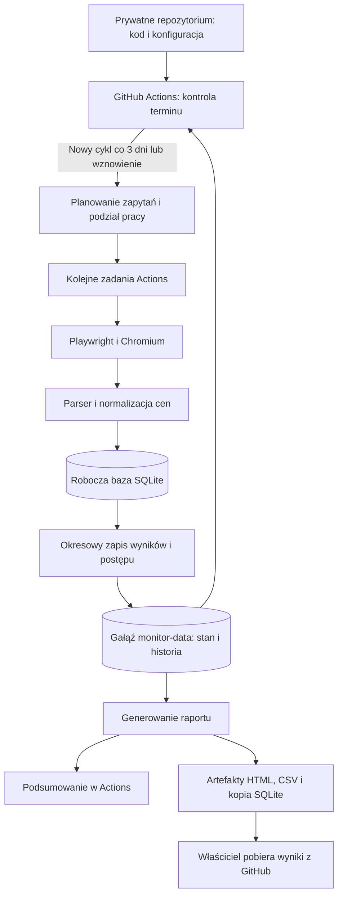

# Architektura prywatnego monitora konkurencji dla jednego apartamentu

Aktualizacja: 04.11.2026. Docelowy model: prywatne repozytorium GitHub i pobieranie danych w GitHub Actions co 3 dni.

## 1. Cel i decyzje projektowe

Aplikacja służy właścicielowi **jednego apartamentu** do obserwowania cen z jednej, ręcznie wskazanej listy konkurencyjnych ofert Booking.com. Co 3 dni rozpoczyna pełny cykl sprawdzania wszystkich dat przyjazdu w kolejnych 3 miesiącach dla pobytów na **2, 3 i 4 noce**. Zapisuje historię oraz przygotowuje raport cen i dostępności.

**Rekomendacja: Python + Playwright + GitHub Actions, trwałe dane w osobnej gałęzi prywatnego repozytorium, SQLite jako odtwarzalna baza robocza i raporty HTML/CSV.** Cały kod, konfiguracja, testy i definicje automatyzacji znajdują się na GitHub. Pobieranie działa na runnerach GitHub i nie wymaga włączonego komputera właściciela.

Dokument opisuje docelową architekturę. Przykłady konfiguracji i workflow są kontraktami do implementacji; aktualizacja tego pliku nie wdraża zmian w istniejącej aplikacji ani nie uruchamia zbierania danych.

| Obszar | Decyzja |
|---|---|
| Własny obiekt | Jeden apartament |
| Konkurencja | Jedna lista adresów Booking.com |
| Repozytorium | Prywatne; kod na domyślnej gałęzi `main` |
| Wykonanie | GitHub Actions, runner Ubuntu, Chromium bez widocznego okna |
| Częstotliwość | Nowy pełny cykl co 3 dni |
| Zakres każdego cyklu | Wszystkie daty przyjazdu w ruchomych 3 miesiącach × 2/3/4 noce |
| Historia i postęp | Gałąź `monitor-data`, niezależna od gałęzi kodu |
| Wyniki dla właściciela | Podsumowanie w Actions oraz raport HTML i CSV do pobrania |
| Panel Streamlit | Opcjonalny lokalny podgląd pobranej bazy, poza procesem zbierania |

Automatyczna zmiana ceny własnej oferty, rezerwacje, obsługa gości i publiczne konta użytkowników pozostają poza zakresem.

## 2. Zakres pomiarów i konfiguracja apartamentu

### Założenia początkowe

- 2 dorosłych, 0 dzieci, 1 jednostka zakwaterowania.
- Waluta PLN, język polski, profil desktopowy, sesja niezalogowana.
- Porównywane zakwaterowanie: cały apartament; opcjonalny filtr konkretnego lokalu u konkurenta.
- Przechowywana historia pomiarów: 12 miesięcy.
- Jedna lista konkurentów bez wyboru własnego apartamentu w raporcie.
- Powtórzony adres tej samej oferty nie tworzy dodatkowych pomiarów.

Liczba gości jest ustawieniem do dopasowania do własnego apartamentu. Przyjmujemy, że „2/3/4 dni” oznacza **2/3/4 noclegi**. Jeżeli chodzi o pobyty obejmujące odpowiednio 1/2/3 noce, wystarczy zmienić listę długości pobytu.

Środowisko GitHub-hosted nie gwarantuje polskiego ani stałego adresu IP. PLN i polski język nie gwarantują ceny identycznej z ceną widoczną na komputerze właściciela. Zapisujemy profil zapytania i identyfikator środowiska; pilotaż musi sprawdzić porównywalność danych z runnera. Wymaganie stałego kraju lub adresu IP oznaczałoby późniejszą zmianę środowiska wykonania.

### Definicja okna dat

```text
cycle_date = data rozpoczęcia cyklu w Europe/Warsaw
end_exclusive = cycle_date przesunięte o 3 miesiące kalendarzowe
checkin = każdy dzień w [cycle_date, end_exclusive)
checkout = checkin + nights, gdzie nights należy do [2, 3, 4]
```

Datę i zakres zamrażamy dla całego cyklu, również gdy składa się z wielu zadań Actions. Kolejny cykl przesuwa okno do nowej daty rozpoczęcia. Nie zmieniamy zakresu w połowie pobierania.

Przykład: cykl rozpoczęty **04.11.2026** obejmuje przyjazdy od **04.11.2026 do 03.02.2027**, czyli 92 daty. Ostatni pobyt czteronocny kończy się **07.02.2027**. Horyzont dotyczy dat przyjazdu, więc wymeldowanie może wypadać poza nim.

Przy przesuwaniu o miesiące nieistniejący dzień zastępujemy ostatnim dniem miesiąca docelowego. Daty pobytów zapisujemy jako daty, a momenty pomiaru w UTC. Jeśli podczas długiego cyklu data przyjazdu stanie się przeszła, jej niewykonane zadania oznaczamy jako wygasłe i pokazujemy w raporcie pokrycia.

## 3. Co uznajemy za porównywalną cenę

Jednostka zapytania: **konkurent × data przyjazdu × liczba nocy × profil gości i sesji**. Cykl identyfikuje kolejną obserwację tego samego zapytania.

Dla każdej oferty zapisujemy:

- wariant zakwaterowania, liczbę jednostek i profil gości;
- kwotę widoczną na stronie i pełny koszt pobytu, jeśli jest znany;
- podatki i obowiązkowe opłaty, z rozróżnieniem wliczonych i niewliczonych;
- warunki anulowania i jego termin graniczny, wyżywienie, przedpłatę i zniżki;
- dostępność, czas odczytu, adres źródła i wersję parsera.

### Zasady obliczeń

```text
pełna_cena = kwota_widoczna + obowiązkowe_opłaty_jeszcze_niewliczone
średnia_za_noc = pełna_cena / liczba_nocy
```

Nie doliczamy podatku lub sprzątania drugi raz. Opłaty zależne od liczby osób i nocy przeliczamy dla rzeczywistego profilu. Zwrotną kaucję zapisujemy osobno, poza ceną pobytu. Kwoty przechowujemy w groszach, a obliczenia wykonujemy przez `Decimal`.

Nieznana obowiązkowa opłata oznacza `total_price = null` i `price_completeness = partial`. Kwotę ze strony można pokazać, ale nie uwzględniać jej w statystykach pełnego kosztu.

Każdą długość pobytu sprawdzamy oddzielnie. Ceny trzech lub czterech nocy nie wyliczamy z ceny dwóch nocy. Średnia za noc jest ilorazem ceny danego pobytu, a nie osobną stawką każdej nocy.

### Taryfy i wybór wariantu

Kategorie: `non_refundable`, `free_cancellation`, `other`, `unknown`. Dla każdego konkurenta wybieramy najtańszy pasujący cały apartament w danej kategorii, po uwzględnieniu filtra lokalu.

Widok najniższej ceny pokazuje warunki wybranej taryfy. Porównanie jednakowych warunków filtruje także wyżywienie, przedpłatę i termin bezpłatnego anulowania. Nieznanych warunków nie traktujemy jako zgodnych ze znanymi. Jeden konkurent wnosi najwyżej jedną cenę do danej statystyki, niezależnie od liczby dostępnych taryf.

## 4. Architektura i przepływ danych



### Moduły

| Moduł | Odpowiedzialność |
|---|---|
| `config` | Walidacja jednego apartamentu, profilu i listy konkurencji |
| `schedule` | Ustalenie, czy wypada nowy cykl, czy trwa poprzedni i czy wymaga wznowienia |
| `planner` | Zamrożenie zakresu, deduplikacja zapytań i zapis planu cyklu |
| `runner` | Pobieranie pozostałych zadań, limity czasu, ponowienia i checkpointy |
| `providers/booking_browser` | Ustawienie dat, gości i waluty oraz odczyt strony |
| `parsing` | Warianty, taryfy, opłaty i rozpoznawanie komunikatów |
| `normalization` | Koszt całkowity, spójność parametrów i kwalifikacja do porównań |
| `storage` | Baza robocza, eksport zdarzeń i odtwarzanie stanu |
| `github_state` | Odczyt i atomowe zatwierdzanie wyników na gałęzi danych |
| `analytics` | Aktualne wyniki, historia i statystyki |
| `reporting` | HTML, CSV, podsumowanie Actions i manifest raportu |

Raport powstaje z już zapisanych wyników. Jego pobranie lub otwarcie nie inicjuje odczytów Booking.

## 5. Technologie

| Element | Wybór |
|---|---|
| Logika i modele | Python, Pydantic |
| Pobieranie | Playwright + Chromium w trybie headless |
| Środowisko wykonania | GitHub-hosted Ubuntu; wersja obrazu przypięta w workflow |
| Konfiguracja | YAML i CSV w prywatnym repozytorium |
| Historia źródłowa | Małe, niezmienne partie JSONL skompresowane gzip na `monitor-data` |
| Stan sterowania | JSON z wersją schematu, planem i identyfikatorami cykli |
| Baza zapytań i analizy | SQLite odtwarzana z trwałych danych |
| Raport | Samodzielny HTML, CSV i Markdown do Actions Summary |
| Testy | pytest, próbki HTML, testy harmonogramu i odtwarzania |
| Zależności | `pyproject.toml` i plik blokujący wersje |

Playwright pozwala lokalizować elementy przez role, etykiety i identyfikatory testowe. Selektory dopasowujemy do aktualnej strony i izolujemy w adapterze. [Dokumentacja Playwright](https://playwright.dev/python/docs/locators).

Wersje Pythona, zależności i przeglądarki dobieramy oraz testujemy wspólnie. Workflow instaluje Chromium z bibliotekami systemowymi wymaganymi na Ubuntu. Cache służy wyłącznie przyspieszeniu instalacji zależności.

## 6. Harmonogram: pełne pobieranie co 3 dni

### Dlaczego kontrola terminu jest oddzielona od zbierania

Wyrażenie cron `17 5 */3 * *` wybiera co trzeci dzień **w obrębie miesiąca**. Nie daje stałego odstępu trzech dni na przełomie miesięcy. Dlatego workflow uruchamia krótką kontrolę codziennie, a aplikacja dopuszcza nowy cykl według daty bazowej i zapisanego stanu.

Proponowana kontrola: **05:17 UTC**, czyli 06:17 czasu polskiego zimą i 07:17 latem. W dni bez należnego cyklu i bez prac do wznowienia nie otwieramy Booking i nie instalujemy przeglądarki.

```yaml
# Fragment projektowanego .github/workflows/collect.yml
name: Monitor konkurencji
on:
  schedule:
    - cron: '17 5 * * *'
  workflow_dispatch:
    inputs:
      mode:
        description: 'Sprawdź termin lub wznów rozpoczęty cykl'
        type: choice
        options: [due, resume]
        default: due
permissions:
  contents: read
concurrency:
  group: booking-monitor-production
  cancel-in-progress: false
```

Workflow harmonogramu musi znajdować się na domyślnej gałęzi. Zaplanowane uruchomienie może być opóźnione lub pominięte przez GitHub, więc godzina jest celem, a nie gwarancją. [Dokumentacja zdarzenia schedule](https://docs.github.com/en/actions/reference/workflows-and-actions/events-that-trigger-workflows#schedule).

### Reguły cykli

```text
anchor_at = ustalony pierwszy termin, np. 2026-11-04T05:17:00Z
period = 72 godziny
slot = floor((now_utc - anchor_at) / period)
```

- Przed `anchor_at` nie rozpoczynamy pobierania.
- Dla nowego `slot` tworzymy jeden cykl; przykładowe terminy to 4, 7, 10 i 13 listopada.
- Stan zapisuje `last_started_slot`, `active_cycle_id` oraz status cyklu. Ponowna kontrola tego samego slotu nie tworzy duplikatu.
- Jeżeli GitHub pominie termin, następna kontrola rozpoczyna zaległy bieżący cykl. Nie uruchamiamy kilku pełnych skanów w celu odtworzenia nieaktualnych cen z przeszłości.
- Błąd lub opóźnienie nie przesuwa daty bazowej; kalendarz następnych slotów pozostaje stały.
- Wznowienie niedokończonego pobierania dotyczy tego samego cyklu i jego pozostałych zapytań. Może nastąpić między planowymi terminami; nie jest dodatkowym pełnym odświeżeniem.
- `workflow_dispatch` z `resume` wznawia istniejący cykl. Tryb `due` stosuje zwykłą kontrolę terminu.
- Jeśli przy kolejnym terminie nadal trwa poprzedni cykl, nie otwieramy drugiego. Raport wskazuje opóźnienie. Po zakończeniu harmonogram podejmuje najnowszy należny slot.
- Brak stanu w istniejącym wdrożeniu oznacza błąd odtworzenia, a nie automatyczne rozpoczęcie historii od zera. Pierwsza inicjalizacja jest osobnym krokiem wdrożenia.

**Każdy cykl obejmuje cały horyzont trzech miesięcy.** Nie stosujemy wcześniejszego podziału na odświeżenia codzienne i cotygodniowe. Raport pokazuje rzeczywisty czas odczytu każdej ceny, ponieważ pełny cykl nie jest pomiarem jednoczesnym.

## 7. Skala, limit czasu Actions i podział pracy

Dla `C` unikalnych konkurentów oraz jednego profilu:

```text
liczba_pomiarów_w_cyklu = C × liczba_dat_przyjazdu × 3
```

| Konkurenci | Daty przyjazdu | Długości pobytu | Pomiary w cyklu |
|---:|---:|---:|---:|
| 5 | 92 | 3 | 1 380 |
| 10 | 92 | 3 | 2 760 |
| 20 | 92 | 3 | 5 520 |

Opcjonalne mierzenie własnej oferty dodaje jeden obiekt. Jedna logiczna obserwacja może powodować wiele żądań sieciowych.

Przykład obliczeniowy, **nie wynik pilotażu**: przy 20 konkurentach oraz średnim czasie 10–20 sekund na pomiar wraz z przerwami pełny cykl zajmuje około **15,3–30,7 godziny** jednego procesu. Cykle co 3 dni dają około 10 pełnych przebiegów na 30 dni, czyli około 153–307 godzin pracy, przed uwzględnieniem instalacji i ponowień.

Pojedyncze zadanie na GitHub-hosted runnerze ma limit **6 godzin**. Dlatego pełnego cyklu nie projektujemy jako jednego wielogodzinnego zadania. Limity wykorzystania i dostępny budżet zależą od konta; nie zakładamy, że opisane obciążenie zmieści się w bezpłatnym użyciu. [Limity GitHub Actions](https://docs.github.com/en/actions/reference/limits).

### Podział jednego cyklu

1. `prepare` odtwarza stan, sprawdza termin i zapisuje niezmienny manifest cyklu: zakres dat, listę konkurentów, profil, hash konfiguracji i wersję kodu.
2. Planner oblicza liczbę okien roboczych na podstawie liczby zapytań, czasu p95 z pilotażu oraz zapasu na ponowienia i uruchamianie środowiska.
3. `collect` wykorzystuje macierz okien roboczych z `max-parallel: 1`. Jeden job ma jedną aktywną kartę przeglądarki, maksymalnie 240 minut pobierania i `timeout-minutes: 300`.
4. Każdy job pobiera **aktualny stan gałęzi danych na początku swojej pracy** i wykonuje pozostałe zadania. Nie polega na kolejności elementów macierzy ani na stanie skopiowanym przez `prepare`.
5. Co 15 minut lub 100 pomiarów, zależnie od tego, co nastąpi wcześniej, zapisuje trwały checkpoint. Po wyczerpaniu czasu kończy pracę kontrolowanie, zostawiając resztę kolejnemu jobowi.
6. `finalize` odtwarza stan i publikuje raport pełny albo częściowy. Nie uznaje cyklu za ukończony wyłącznie dlatego, że wszystkie procesy zakończyły się bez awarii.

Liczbę okien wyliczamy przed uruchomieniem macierzy; jest skończona. Jeśli okien zabraknie, stan pozostaje `partial`, a kolejna kontrola lub ręczne `resume` planuje brakującą pracę. Nie ukrywamy tego jako pełnego odświeżenia. Przed produkcją pilotaż musi potwierdzić wykonanie cyklu w mniej niż 72 godziny, z zapasem na opóźnienia GitHub.

Wspólna grupa `concurrency` obejmuje cały workflow automatyczny i ręczny, a `cancel-in-progress: false` chroni aktywny cykl przed anulowaniem przez nowy start. To rozwiązanie nie zastępuje trwałego stanu, bo oczekujące uruchomienia nie są kolejką biznesową. [Składnia concurrency](https://docs.github.com/en/actions/reference/workflows-and-actions/workflow-syntax#concurrency).

## 8. Trwałe dane pomiędzy uruchomieniami

Runnery GitHub-hosted są środowiskami tymczasowymi. Plik SQLite zapisany wyłącznie na dysku joba nie jest trwałą bazą dla następnego uruchomienia. [Opis runnerów GitHub-hosted](https://docs.github.com/en/actions/concepts/runners/github-hosted-runners).

### Gałąź `monitor-data` jako źródło prawdy

Proponowany układ:

```text
monitor-data/
├── state/
│   ├── scheduler.json
│   └── schema-version.json
├── cycles/
│   └── <cycle_id>/
│       ├── manifest.json
│       ├── progress.json
│       └── batches/
│           ├── <batch_id_1>.jsonl.gz
│           └── <batch_id_2>.jsonl.gz
└── reports/
    └── latest.json
```

- Partia wyników zawiera niezmienne obserwacje, warianty ofert, składniki cen i wyniki prób. Jej identyfikator i suma kontrolna pozwalają wykryć powtórny import lub uszkodzenie.
- Wyniki partii i postęp wskazujący na tę partię trafiają do **tego samego commita**. Dopiero potwierdzony push oznacza trwały checkpoint.
- Po nieudanym pushu proces ponawia sam zapis. Nie pobiera ponownie już zebranych cen, dopóki ma ich lokalną kopię.
- Po utracie runnera odtwarzamy stan z ostatniego zatwierdzonego commita. Można utracić pracę od ostatniego checkpointu; te zapytania zostaną ponowione.
- Kolejny job odbudowuje SQLite i kolejkę z manifestów oraz zapisanych zdarzeń. Baza jest indeksem roboczym, a nie jedyną kopią historii.
- Nowe wdrożenie tworzy gałąź danych i początkowy stan jawnie. Brak dostępu, niezgodna wersja schematu lub uszkodzona partia zatrzymują odtwarzanie.
- `main` zawiera kod; workflow zbierający zapisuje tylko `monitor-data`. Workflow CI reaguje na kod, a nie na każdy commit pomiarów.

Nie zapisujemy zmieniającego się pliku SQLite ani zrzutów całych stron w każdym commicie. Partie są małe, skompresowane i po zapisie niezmienne. To ogranicza przyrost historii Git.

Dwanaście miesięcy oznacza zakres danych odtwarzanych do analizy. Usunięcie plików z bieżącej wersji gałęzi nie usuwa ich ze starych commitów. Monitorujemy rozmiar repozytorium; przy znacznym wzroście kolejnym krokiem jest magazyn obiektowy, bez zmiany formatu partii. GitHub stosuje limity plików i zaleca kontrolę wielkości repozytoriów. [Duże pliki na GitHub](https://docs.github.com/en/repositories/working-with-files/managing-large-files/about-large-files-on-github).

### Artefakty i kopie dla właściciela

Każdy raport jest publikowany jako artefakt workflow: `report.html`, `prices.csv`, `manifest.json` oraz opcjonalna spójna kopia SQLite. Retencja startowa: 30 dni, w granicach ustawień repozytorium. To wygodny kanał pobierania; historia pozostaje na gałęzi danych także po wygaśnięciu artefaktu. [Artefakty workflow](https://docs.github.com/en/actions/tutorials/store-and-share-data).

Kopię SQLite tworzymy przez mechanizm backupu po odtworzeniu danych. Nie kopiujemy samodzielnie otwartego pliku bez uwzględnienia stanu transakcji. [SQLite Online Backup](https://sqlite.org/backup.html).

## 9. Model danych

| Encja / tabela robocza | Najważniejsze pola |
|---|---|
| `own_apartment` | Jeden rekord: `id`, `name`, opcjonalny adres własnej oferty |
| `competitors` | `id`, nazwa, adres kanoniczny, opcjonalny identyfikator Booking, filtr lokalu, aktywność |
| `search_profiles` | Niezmienna wersja parametrów gości, języka, waluty i sesji oraz `profile_hash` |
| `cycles` | `id`, `schedule_slot`, zakres dat, status, hash konfiguracji, commit kodu, początek i koniec |
| `stay_queries` | Konkurent, check-in, check-out, liczba nocy, profil i źródło |
| `jobs` | `cycle_id`, `query_id`, status, liczba prób, następna próba, dzierżawa |
| `attempts` | Identyfikator próby, zadanie, workflow run, czas i wynik techniczny |
| `observations` | Zapytanie, cykl, próba, czas pomiaru, wynik dostępności i wersja parsera |
| `offers` | Obserwacja, lokal, taryfa, warunki, kwoty, waluta, kompletność |
| `price_components` | Oferta, opłata, kwota, podstawa naliczenia, obowiązkowość i wliczenie |
| `imported_batches` | Identyfikator partii i suma kontrolna; ochrona przed ponownym importem |

Zapytanie jest unikalne dla `(competitor_id, checkin, checkout, profile_hash, source)`. Zadanie jest unikalne dla `(cycle_id, query_id)`. Ta sama próba ma najwyżej jedną obserwację. Nowy cykl dodaje historię, a nie nadpisuje wcześniejszej ceny.

Nie ma tabeli grup własnych apartamentów ani przełączania między nimi. Parametry pojedynczego apartamentu i profil porównania pochodzą z konfiguracji zamrożonej dla cyklu.

### Wyniki i stany

| Poziom | Wartości |
|---|---|
| Cykl | `planned`, `running`, `partial`, `completed`, `completed_with_errors`, `blocked` |
| Zadanie | `pending`, `running`, `retry_wait`, `completed`, `failed`, `expired` |
| Dostępność | `available`, `unavailable`, `no_matching_offer`, `unknown` |
| Przyczyna techniczna | `timeout`, `network_error`, `blocked`, `parse_error`, `context_mismatch` |

`unavailable` wymaga jednoznacznego komunikatu dla sprawdzonych parametrów. Nie oznacza automatycznie rezerwacji — przyczyną może być ograniczenie długości pobytu. Błąd parsera lub blokada nie są niedostępnością. Dostępna oferta może mieć niepełną cenę i nie kwalifikować się do statystyk.

## 10. Pobieranie i obsługa błędów

### Jedna obserwacja

1. Otworzyć konkretną ofertę i ustawić daty, gości oraz walutę.
2. Potwierdzić parametry na wyrenderowanej stronie; sam adres URL nie wystarcza.
3. Poczekać na sekcję dostępności albo jednoznaczny komunikat.
4. Odczytać warianty i taryfy, przeliczyć opłaty oraz sprawdzić spójność.
5. Zapisać wynik w lokalnej transakcji i uwzględnić go w następnym checkpointcie.

Podstawą jest sekcja dostępności konkretnego obiektu. Kwota „od” z ogólnego opisu nie jest ceną żądanego pobytu. Brak obiektu na stronie wyników wyszukiwania nie jest dowodem niedostępności. Odczyt list wyników można dodać później, po potwierdzeniu kompletności.

### Reguły odporności

- Jedna aktywna karta i konfigurowalny odstęp między nawigacjami, startowo 10 sekund.
- Maksymalnie 3 próby dla przejściowych błędów, z rosnącą przerwą i zapisem `next_attempt_at`.
- HTTP 429 respektuje `Retry-After`; długie oczekiwanie zapisujemy w stanie zamiast bez potrzeby zajmować runner.
- CAPTCHA lub blokada zatrzymuje źródło i zapisuje `blocked`. Następne zaplanowane joby widzą ten stan i kończą bez wejścia na Booking. Wznowienie wymaga sprawdzenia sytuacji.
- Pięć kolejnych błędów parsera zatrzymuje serię i zachowuje ograniczoną diagnostykę.
- Zakończenie budżetu joba powoduje checkpoint i kontrolowane wyjście. Twarde anulowanie może uniemożliwić ostatni zapis, dlatego checkpoint jest okresowy.
- Workflow uruchamia raportowanie i próbę zapisania diagnostyki również po błędzie; nie traktujemy `always()` jako gwarancji zapisu po utracie runnera.
- Porażka odświeżenia pozostawia starszą cenę z jej oryginalnym czasem. Nie nadajemy jej nowej daty.
- Zmiana konfiguracji w trakcie cyklu nie modyfikuje manifestu. Nowy zakres obowiązuje od następnego cyklu.

Próbki HTML i zrzuty błędów trafiają do krótkotrwałego artefaktu, domyślnie na 7 dni. Logi nie zawierają tokenów ani danych sesji. Pilotaż wykonujemy na docelowym runnerze GitHub, bo powodzenie lokalnego odczytu nie potwierdza działania w tym środowisku.

## 11. Raport i korzystanie z aplikacji

Właściciel otwiera zakładkę **Actions** w prywatnym repozytorium i wybiera ostatni cykl. Podsumowanie pokazuje czas pomiarów, pokrycie, liczbę błędów i identyfikator artefaktu. Raport HTML i CSV pobiera do przeglądarki lub Excela.

GitHub Actions uruchamia procesy okresowe; nie projektujemy go jako stałego serwera Streamlit. Raport HTML jest samodzielnym plikiem z osadzonymi danymi i zasobami, możliwym do otwarcia po pobraniu, bez zewnętrznych żądań. Opcjonalny Streamlit czyta pobraną bazę na komputerze właściciela.

| Widok | Zawartość |
|---|---|
| Przegląd | Nazwa jednego apartamentu, termin cyklu, pokrycie i błędy |
| Kalendarz | Przyjazdy, 2/3/4 noce, minimum i mediana ceny pobytu |
| Konkurenci | Lokal, pełna cena, średnia za noc, warunki, dostępność i czas odczytu |
| Historia | Zmiany ceny tego samego pobytu między cyklami |
| Stan danych | Pomiary wykonane, brakujące, wygasłe i nieporównywalne |

Statystyki obejmują wyłącznie kompletne, porównywalne ceny z wybranego cyklu. Pokazujemy mianownik, np. „12 porównywalnych cen / 20 konkurentów”. Starsze wyniki można wyświetlić z oznaczeniem, ale nie uzupełniają automatycznie statystyk aktualnego cyklu.

Przy nowej niedostępności stara cena zostaje w historii. Przy błędzie nowego odczytu można pokazać ostatnią cenę z jej datą i komunikatem o błędzie. Mniej niż 5 porównywalnych cen oznaczamy jako małą próbę. Nie szacujemy obłożenia rynku z samej liczby niedostępnych ofert.

Raport pokazuje najstarszy i najnowszy czas obserwacji. Cykl ukończony z błędami pozostaje oznaczony jako niepełny jakościowo. Nie przedstawiamy danych z kilkunastogodzinnego zbierania jako jednej chwili pomiaru.

CSV: UTF-8 z BOM, separator `;`, daty ISO, cena i waluta, warunki, dostępność, `cycle_id` i `observed_at`. Pola tekstowe zabezpieczamy przed interpretacją jako formuły arkusza.

## 12. Konfiguracja docelowa

```yaml
report_timezone: Europe/Warsaw

own_apartment:
  id: moj_apartament
  name: Mój apartament

profile:
  adults: 2
  children_ages: []
  units: 1
  currency: PLN
  locale: pl-PL
  device: desktop
  logged_in: false
  accommodation_type: entire_apartment

collection:
  provider: booking_browser
  horizon_months: 3
  stay_nights: [2, 3, 4]
  refresh_mode: full_cycle

schedule:
  interval_hours: 72
  anchor_at_utc: '2026-11-04T05:17:00Z'
  gate_cron_utc: '17 5 * * *'

execution:
  parallel_jobs: 1
  browser_pages: 1
  navigation_timeout_seconds: 45
  min_navigation_interval_seconds: 10
  max_attempts: 3
  collection_budget_minutes_per_job: 240
  job_timeout_minutes: 300
  checkpoint_interval_minutes: 15
  checkpoint_max_observations: 100

storage:
  state_branch: monitor-data
  working_database: .runtime/monitor.sqlite3
  history_retention_days: 365
  report_artifact_retention_days: 30
  diagnostics_artifact_retention_days: 7
```

`anchor_at_utc` ustalamy przy pierwszym wdrożeniu; powyższa data jest przykładem. `gate_cron_utc` dokumentuje harmonogram, ale faktycznym wyzwalaczem jest wpis w pliku workflow. Test CI powinien sprawdzać zgodność obu wartości.

Lista `config/competitors.csv` nie potrzebuje kolumny własnego apartamentu:

```csv
competitor_key;name;booking_url;unit_filter;enabled
konkurent_a;Konkurent A;UZUPELNIJ_ADRES_BOOKING_A;;true
konkurent_b;Konkurent B;UZUPELNIJ_ADRES_BOOKING_B;;true
```

Placeholdery są odrzucane przez walidator przed uruchomieniem przeglądarki. Powtórzone adresy deduplikujemy, a sprzeczne nazwy lub filtry zgłaszamy jako błąd konfiguracji.

## 13. Repozytorium, workflow i uprawnienia

```text
booking-monitor/                      # gałąź main
├── ARCHITEKTURA.md
├── README.md
├── pyproject.toml
├── uv.lock
├── .github/workflows/
│   ├── ci.yml                        # testy po zmianie kodu
│   └── collect.yml                   # gate -> prepare -> collect -> finalize
├── config/
│   ├── settings.yaml
│   └── competitors.csv
├── src/booking_monitor/
│   ├── cli.py
│   ├── config.py
│   ├── schedule.py
│   ├── planner.py
│   ├── runner.py
│   ├── providers/booking_browser.py
│   ├── parsing/
│   ├── normalization.py
│   ├── storage/
│   ├── github_state.py
│   ├── analytics.py
│   └── reporting.py
└── tests/
    ├── fixtures/
    ├── test_dates.py
    ├── test_schedule.py
    ├── test_prices.py
    ├── test_parser.py
    └── test_checkpoint_resume.py
```

`ci.yml` uruchamia testy offline na `push` do gałęzi kodu i przy pull requestach. Nie pobiera cen. `collect.yml` działa z harmonogramu lub ręcznie, z zatwierdzonym kodem domyślnej gałęzi; wznowienie korzysta z wersji kodu zapisanej w manifeście cyklu.

Domyślne uprawnienia to `contents: read`. Wyłącznie joby zapisujące checkpointy i stan otrzymują `contents: write` dla `GITHUB_TOKEN`. Repozytorium musi pozwalać na zapis do dedykowanej gałęzi danych. Kod nie korzysta z tokena do modyfikacji `main`. Jeśli zapis zostanie zablokowany, cykl nie jest oznaczany jako utrwalony.

Akcje zewnętrzne przypinamy do zweryfikowanych commitów. Sekrety przechowujemy w GitHub Secrets; nie są potrzebne dane logowania do prywatnego konta Booking. Nie publikujemy prywatnych danych przez GitHub Pages — dostęp do wyników odbywa się przez prywatne repozytorium i jego artefakty.

Raporty i stan zawierają identyfikatory `github.run_id`, próby workflow, cyklu, wersji parsera i kodu. Dzięki temu można odtworzyć pochodzenie konkretnej ceny.

## 14. Plan wdrożenia

1. **Repozytorium i konfiguracja:** prywatny GitHub, jeden apartament, lista konkurentów, data bazowa harmonogramu, jawna inicjalizacja `monitor-data`.
2. **Pilotaż na GitHub Actions:** 2–3 oferty, kilka dat, wszystkie długości pobytu; ręczna kontrola około 20 odczytów, czasu p95 i zachowania źródła na runnerze.
3. **Historia i wznowienia:** manifesty, partie wyników, checkpointy, odtwarzanie SQLite i kontynuacja na nowym runnerze.
4. **Cykl co 3 dni:** kontrola terminu, podział na joby, blokada równoległych cykli oraz obsługa pominiętych wywołań.
5. **Raporty:** HTML/CSV, podsumowanie Actions, oznaczenie braków i historii.
6. **Pełny przebieg:** rzeczywista lista konkurentów, trzy miesiące, kontrola jakości, czasu i kosztu. Harmonogram produkcyjny włączamy po potwierdzeniu wykonalności tego zakresu.

Opcjonalne rozszerzenia: odczyt własnej oferty tym samym profilem, osobny profil liczby gości, powiadomienia o zmianach oraz zewnętrzny magazyn danych przy zwiększeniu skali. Porównywanie własnej ceny wymaga pełnego kosztu konkretnego pobytu; stawka bazowa za noc nie jest wystarczającym odpowiednikiem.

## 15. Kryteria odbioru

1. Konfiguracja opisuje jeden własny apartament i jedną listę konkurentów; raport nie zawiera przełącznika apartamentów.
2. Każdy cykl obejmuje wszystkie daty przyjazdu w trzech miesiącach dla 2/3/4 nocy; generator obsługuje granice miesięcy, roku i zmianę czasu.
3. Terminy nowych cykli zachowują odstęp 72 godzin według daty bazowej także na przełomie miesięcy. Ponowna kontrola tego samego slotu nie tworzy nowego cyklu.
4. Testy harmonogramu obejmują pominięty trigger, ręczne wznowienie, opóźniony cykl i brak stanu; nie uruchamiają Booking w zwykłym dniu kontroli.
5. Praca po utracie runnera wznawia się od ostatniego trwałego checkpointu, bez zdublowania zapisanych prób.
6. Wygaśnięcie wszystkich artefaktów nie usuwa historii i nie uniemożliwia odtworzenia bazy z `monitor-data`.
7. Każdy job kończy zbieranie przed własnym limitem i zapisuje postęp. Nieukończony cykl daje raport częściowy.
8. Testy cen obejmują dopłaty, brak podwójnego naliczenia, nieznane koszty, różne taryfy i średnią za noc.
9. Testy parsera rozróżniają dostępność, brak pasującej oferty, blokadę oraz zmianę strony. Weryfikacja rzeczywistych cen odbywa się na runnerze docelowym.
10. Raport podaje czas odczytu, cykl, pokrycie i warunki porównania. Starsze ceny nie udają nowych pomiarów.
11. Pełny pilotaż potwierdza ukończenie cyklu przed następnym terminem oraz akceptowalne wykorzystanie GitHub Actions.
12. Wyniki można pobrać z prywatnego repozytorium i otworzyć bez działającego serwera aplikacji.

Do wdrożenia potrzebne są adresy konkurentów, profil gości własnego apartamentu, repozytorium GitHub i data pierwszego cyklu. Do aktualizacji samej architektury nie są one wymagane.
