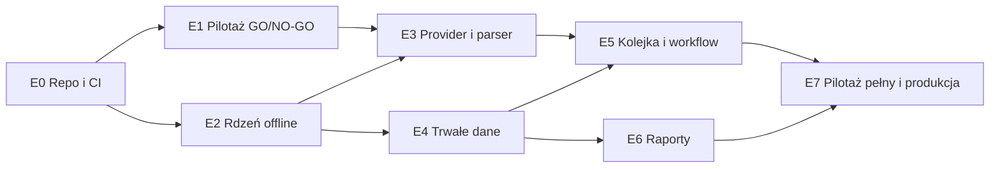

# Plan działania — monitor konkurencji dla jednego apartamentu

Data: 04.11.2026. Podstawa: dokument architektury z 04.11.2026 (dalej „A§n” = sekcja n architektury).
Plan dotyczy wdrożenia od zera — repozytorium `ringil-coder/Booking_scraper` nie zawiera jeszcze kodu.

## 0. Podsumowanie

Kolejność prac jest ułożona tak, aby **najpierw sprawdzić największe ryzyka**, a dopiero potem budować infrastrukturę:

1. Czy Booking.com da się odczytać z runnera GitHub (adres IP centrum danych) bez blokad i z porównywalną ceną?
2. Czy pełny cykl zmieści się w 72 godzinach? (Repozytorium jest publiczne, więc minuty Actions nie są kosztem — §3.)

Względem A§14 zmieniam jedną rzecz: **krótki pilotaż techniczny (etap E1) odbywa się przed budową kolejki, checkpointów i raportów** i kończy się decyzją GO/NO-GO. Pozostałe etapy odpowiadają A§14. Tylko je rozdrabniam na zadania z wynikami i testami.

| Etap | Cel | Wynik | Bramka | Szacunek* |
|---|---|---|---|---|
| E0 | Repozytorium, szkielet, CI | Publiczne repo z regułami gałęzi, zielone CI | CI zielone | 0,5–1 dnia |
| E1 | Pilotaż techniczny na runnerze | Pomiary czasu, jakości i blokad, próbki HTML | **GO/NO-GO** | 2–3 dni |
| E2 | Rdzeń domenowy offline | Konfiguracja, daty, harmonogram, ceny + testy | Testy zielone | 3–4 dni |
| E3 | Odczyt Booking, parser, normalizacja | `providers/`, `parsing/`, `normalization` | Testy na próbkach | 4–6 dni |
| E4 | Trwałe dane i odtwarzanie | Partie JSONL.gz, `monitor-data`, SQLite | Test wznowienia | 4–5 dni |
| E5 | Kolejka, checkpointy, workflow | `planner`, `runner`, `collect.yml` | Pełny cykl offline | 3–5 dni |
| E6 | Raporty | HTML, CSV, podsumowanie Actions | Testy raportu | 3–4 dni |
| E7 | Pilotaż pełny i produkcja | Włączony harmonogram | Kryteria A§15 | 1–2 dni + 1–2 tyg. obserwacji |

\* Szacunek pracy jednej osoby w dniach roboczych; orientacyjny, do korekty po E1. Łącznie około 20–30 dni roboczych oraz 2–3 cykle obserwacji produkcyjnej.

## 1. Stan wyjściowy i blokery

| # | Ustalenie (stan na 04.11.2026) | Konsekwencja |
|---|---|---|
| B1 | Repozytorium jest **publiczne**. | Rozstrzygnięte decyzją D1 (04.11.2026): zostaje publiczne. Jawne są lista konkurentów, gałąź `monitor-data` z historią cen, logi i artefakty Actions. Środki ostrożności: R8–R10. |
| B2 | Minuty Actions w repozytorium publicznym. | Standardowe runnery w repozytoriach publicznych są według dokumentacji GitHub bezpłatne (do potwierdzenia na stronie rozliczeń). D2 traci znaczenie kosztowe; ograniczeniem zostaje czas cyklu (72 h). |
| B3 | Brak `ARCHITEKTURA.md` w repozytorium. | Dodać w E0 jako dokument źródłowy. |
| B4 | Nazwa repozytorium (`Booking_scraper`) różni się od nazwy z A§13 (`booking-monitor`). | Zostawiamy nazwę repozytorium, pakiet Pythona to `booking_monitor`. Nic więcej nie trzeba zmieniać. |

## 2. Decyzje właściciela

| ID | Decyzja | Rekomendacja | Potrzebna przed |
|---|---|---|---|
| D1 | Widoczność repozytorium | **Publiczne** — decyzja właściciela z 04.11.2026 (zmiana względem pierwotnego A§1). | ✅ |
| D2 | Plan GitHub i limit wydatków na Actions | Przy repozytorium publicznym bez znaczenia kosztowego (B2). Limit wydatków zostawić na 0 USD, żeby nic płatnego nie uruchomiło się przypadkiem. | — |
| D3 | Profil gości (dorośli, dzieci) | Dopasować do własnego apartamentu; domyślnie 2 dorosłych. | E3 |
| D4 | Lista konkurentów | 2–3 adresy na E1; pełna lista przed E7. | E1 / E7 |
| D5 | „2/3/4 dni” = 2/3/4 noce | Potwierdzić (domyślnie noce, A§2). | E2 |
| D6 | `anchor_at_utc` | Dzień włączenia produkcji. Godzinę ustawić **kilka minut przed** cronem kontroli (np. `05:00:00Z` przy `17 5 * * *`), żeby kontrola nigdy nie wypadała na granicy slotu. | E7 |
| D7 | Postępowanie po `blocked` (CAPTCHA/blokada) | Cykl pozostaje zablokowany. Kontrola nie otwiera nowego cyklu i kończy się błędem, więc GitHub wyśle e-mail o nieudanym uruchomieniu. Odblokowanie wyłącznie ręcznie, przez `workflow_dispatch` z jawnym potwierdzeniem (nowy input, np. `confirm_unblock: true`). A§6 przewiduje tylko `due`/`resume`, więc to małe rozszerzenie kontraktu. | E5 |
| D8 | Pomiar własnej oferty | Poza MVP (opcja z A§14). | — |
| D9 | Akceptacja ryzyka regulaminowego (R3) | Świadoma decyzja właściciela przed pierwszym odczytem. | E1 |

## 3. Budżet minut i czasu — rachunek do sprawdzenia w E1

Wzór z A§7: `pomiary = C × ~92 daty × 3 długości`. Minuty na cykl to `pomiary × t / 60`, gdzie `t` to czas pomiaru razem z przerwą. Do tego dochodzi narzut instalacji około 3–5 min na każdy job.

| Konkurenci | Pomiary/cykl | Minuty/cykl (t = 10–20 s) | Minuty/30 dni (~10 cykli) |
|---:|---:|---:|---:|
| 5 | 1 380 | 230–460 | 2 300–4 600 |
| 10 | 2 760 | 460–920 | 4 600–9 200 |
| 20 | 5 520 | 920–1 840 | 9 200–18 400 |

Codzienna kontrola terminu bez pracy kosztuje około 1–2 min dziennie.

Repozytorium jest publiczne (D1), a standardowe runnery w repozytoriach publicznych są według dokumentacji GitHub bezpłatne (do potwierdzenia na stronie rozliczeń). Minuty z tabeli nie są więc kosztem, ale nadal wyznaczają **czas cyklu**: musi się zmieścić w 72 h, z zapasem (kryterium E1: p95 ≤ 48 h). Przy prywatnym repozytorium obowiązywałby limit planu (Free: 2 000 min/mies.), który przekracza już 5 konkurentów. Liczbę konkurentów dobieramy po zmierzeniu `t` w E1.

## 4. Ryzyka krytyczne

| ID | Ryzyko | Weryfikacja | Reakcja |
|---|---|---|---|
| R1 | Booking pokazuje CAPTCHA lub blokuje adresy IP centrów danych (runnery GitHub). | E1 | Zgodnie z A§10 **nie obchodzimy blokad** (bez rotacji proxy i rozwiązywania CAPTCHA). Przy NO-GO zostaje zmiana środowiska wykonania, czyli decyzja architektoniczna. |
| R2 | Cykl nie mieści się w 72 h albo w budżecie minut. | E1, potem E7 | Mniej konkurentów, krótszy horyzont albo inne środowisko wykonania. |
| R3 | Warunki korzystania: regulamin Booking.com dotyczący automatycznego pobierania. Do tego warunki GitHub Actions: wersje archiwalne zakazywały „any other activity unrelated to the production, testing, deployment, or publication of the software project associated with the repository”. Obecnego brzmienia nie udało się potwierdzić. | Przed E1 (D9) | Gdyby zakaz obowiązywał, ten sam kod CLI można uruchamiać poza Actions (np. cron na własnym serwerze). Dlatego CLI nie może zależeć od Actions — patrz zasada P1. |
| R4 | Zmiany strony Booking psują selektory. | Stale | Selektory w jednym miejscu, `PARSER_VERSION`, testy na próbkach. Pięć kolejnych `parse_error` zatrzymuje serię (A§10). |
| R5 | Cena z runnera spoza Polski różni się od ceny widocznej u właściciela. | E1 (~20 odczytów ręcznie) | Zapisujemy profil i środowisko (A§2). Przy istotnych różnicach — decyzja o środowisku. |
| R6 | Przyrost repozytorium: około 100+ partii na cykl, ponad 10 tys. plików rocznie. | E7 i później | Monitorowanie rozmiaru. Opcjonalne łączenie partii zakończonych cykli albo magazyn obiektowy (A§8). |
| R7 | Przypadkowe nadpisanie lub usunięcie `main` albo `monitor-data`. | E0 | Repozytorium publiczne ma reguły gałęzi (rulesets) także na planie Free: dla `main` i `monitor-data` blokada force-push i usunięcia. Na `monitor-data` **bez** wymogu PR — tam pisze `GITHUB_TOKEN`. Dodatkowo push tylko jawnym refspec i test statyczny (E5). |
| R8 | Jawność danych w publicznym repozytorium: lista konkurentów, historia cen, logi, raporty i diagnostyka (kopie stron Booking na 7 dni). | Stale | W konfiguracji żadnych danych osobowych ani sekretów. Zapisany HTML i adres strony przechodzą przez `redaction.py` (bez identyfikatora sesji, tokenów CSRF i etykiet śledzących). Kopie stron w artefaktach wchodzą w zakres decyzji D9 (R3). |
| R9 | GitHub wyłącza zaplanowane workflow w repozytoriach publicznych po 60 dniach bez aktywności w repozytorium. Czy liczą się commity bota na `monitor-data` — do sprawdzenia. | E7, potem stale | GitHub wysyła e-mail; włączenie jednym kliknięciem (Actions → „Monitor konkurencji” → Enable workflow). Przy przerwie > 60 dni sprawdzić stan harmonogramu. |
| R10 | Każdy może otworzyć PR z forka. | E0, E5 | `collect.yml` i `spike.yml` mają tylko `schedule` i `workflow_dispatch`; żaden workflow nie używa `pull_request_target` ani `workflow_run`; CI dla PR tylko do odczytu, bez zapisanych poświadczeń — pilnują tego testy statyczne. W ustawieniach Actions: zatwierdzanie workflow z PR od zewnętrznych współtwórców. |

## 5. Zasady implementacyjne przyjęte w planie

- **P1. CLI niezależne od Actions.** Cała logika żyje w `booking_monitor.cli`. Workflow tylko wywołuje komendy (`gate`, `prepare`, `collect`, `finalize`, `report`, `init-data`, `restore`). Stan Git obsługujemy zwykłym `git`, bez API GitHub.
- **P2. Parser jako czysta funkcja na zrzucie DOM.** Provider zwraca wyrenderowany HTML (po interakcjach, jeśli są potrzebne). Parser przetwarza sam HTML, więc da się go testować offline na próbkach.
- **P3. Funkcje decyzyjne bez efektów ubocznych.** `schedule` i `planner` przyjmują `(now, stan, konfiguracja)` i zwracają decyzję. Dzięki temu testy harmonogramu nie wymagają sieci ani zegara.
- **P4. Kolejność zadań w cyklu.** Najpierw najbliższe daty przyjazdu, bo wygasają najwcześniej. W obrębie daty kolejność jest przeplatana między konkurentami, żeby nie odpytywać jednej oferty seriami.
- **P5. Płytkie pobieranie danych.** Odtworzenie wymaga tylko bieżącego drzewa `monitor-data`, nie historii. Wystarczy `git fetch --depth=1 origin monitor-data` i osobny `git worktree`.
- **P6. Bezpieczeństwo workflow.** Akcje przypięte do SHA, `ubuntu-24.04` zamiast `latest`, domyślnie `contents: read`, a `write` tylko w jobach zapisujących stan.

## 6. Etapy i zadania

### E0. Repozytorium i szkielet (0,5–1 dnia)

- [x] Widoczność repozytorium: publiczne (D1, 04.11.2026).
- [ ] Limit wydatków na Actions zostawić na 0 USD (D2).
- [ ] Reguły gałęzi (R7): `main` i `monitor-data` — blokada force-push i usunięcia.
- [ ] Ustawienia Actions (R10): zatwierdzanie workflow z PR od zewnętrznych współtwórców.
- [ ] Dodać `ARCHITEKTURA.md`, `README.md` i ten plan.
- [ ] `pyproject.toml` (Python 3.12), `uv.lock`, układ katalogów z A§13 i pusty `cli.py`.
- [ ] Narzędzia: `pytest`, `ruff`, opcjonalnie `mypy`; zależności: `pydantic`, `pyyaml`, `playwright`, `jinja2`, `python-dateutil`, `time-machine` (testy).
- [ ] `.github/workflows/ci.yml`: `uv sync --frozen`, `ruff`, `pytest`, bez instalacji przeglądarki. Uruchamiany przy push do `main` i przy PR.
- [ ] Ustawienia repozytorium: domyślne uprawnienia workflow tylko do odczytu; retencja artefaktów zgodna z A§8.

**Wynik:** publiczne repozytorium z regułami gałęzi i zielonym CI.

### E1. Pilotaż techniczny na runnerze GitHub — bramka GO/NO-GO (2–3 dni)

Wymaga D4 i D9. Repozytorium jest publiczne, więc artefakt pilotażu jest jawny (R8).

- [ ] Skrypt `spike/probe.py`: Chromium headless, kontekst `pl-PL`, strefa `Europe/Warsaw`, profil desktop. Otwiera ofertę z parametrami dat, gości, waluty i języka, obsługuje baner zgód (odrzuca opcjonalne), czeka na sekcję dostępności albo komunikat. Zapisuje HTML, zrzut ekranu i czasy etapów.
- [ ] Workflow `spike.yml` (tylko `workflow_dispatch`): 2–3 oferty × 3–4 daty × 2/3/4 noce, czyli około 20–36 odczytów, z odstępem 10 s. Artefakt przechowywany 7 dni.
- [ ] Ręczne porównanie około 20 odczytów z przeglądarką właściciela: cena, waluta, warunki, dostępność.
- [ ] Metryki: odsetek udanych odczytów, CAPTCHA i blokady, mediana i p95 czasu pomiaru, zgodność parametrów na stronie, różnice cen.
- [ ] Przeliczenie §3 dla docelowej liczby konkurentów na zmierzonym `t`.
- [ ] Wybór próbek HTML do testów E3: dostępne, niedostępne, brak pasującej oferty, opłaty niewliczone, kilka taryf, zmieniona lub uszkodzona strona. Próbki trzeba zanonimizować (bez cookies i identyfikatorów sesji).

**Kryteria GO** (do potwierdzenia przez właściciela):

- brak CAPTCHA i blokad w serii pilotażowej;
- co najmniej 95% odczytów bez błędu technicznego;
- ceny zgodne z kontrolą ręczną albo różnice wyjaśnione (np. podatek wliczony lub niewliczony);
- czas cyklu wyliczony z p95 nie przekracza około 48 h (zapas do 72 h);
- przy repozytorium publicznym minuty nie są kosztem (B2); liczy się czas cyklu z poprzedniego punktu.

**NO-GO:** zmniejszenie zakresu albo zmiana środowiska wykonania. Do tego etapu nie powstaje kod infrastruktury, który trzeba by wyrzucić.

### E2. Rdzeń domenowy offline (3–4 dni) — może ruszyć równolegle z E1

- [ ] `config.py`: modele Pydantic dla `settings.yaml` i `competitors.csv` (separator `;`). Walidator:
  - odrzuca placeholdery `UZUPELNIJ_…`;
  - wymaga adresu oferty `booking.com/hotel/…`;
  - kanonikalizuje adresy: bez parametrów i fragmentu, z ujednoliconym wariantem językowym, np. `.pl.html` i `.en-gb.html` to ta sama oferta;
  - deduplikuje adresy, a sprzeczne nazwy lub filtry zgłasza jako błąd;
  - liczy stabilny `config_hash` i `profile_hash`.
- [ ] Okno dat (A§2): `cycle_date` w `Europe/Warsaw`, przesunięcie o 3 miesiące z przycięciem do ostatniego dnia miesiąca, check-in w `[start, end)`, check-out = check-in + noce. Definicja „przeszłej” daty: check-in wcześniejszy niż bieżąca data w `Europe/Warsaw` w chwili pobrania zadania.
- [ ] `schedule.py` (A§6): `slot = floor((now − anchor) / 72 h)`. Możliwe decyzje: `idle`, `start_new(slot)`, `resume(cycle_id)`, `wait_active`, `blocked`, `error_missing_state`. Obsługa trybów `due`, `resume` i odblokowania (D7).
- [ ] Ceny (A§3): grosze jako `int`, obliczenia na `Decimal`, pełna cena, średnia za noc, `price_completeness`, kategorie taryf, wybór najtańszego pasującego lokalu w kategorii, reguły porównywalności (wyżywienie, przedpłata, termin anulowania; nieznane ≠ znane).
- [ ] Testy:
  - `test_dates.py`: przejście 31→30, luty, rok przestępny 2028, przełom roku, zmiana czasu 28.03.2027 i 31.10.2027, przykład z A§2 (92 daty, ostatni wyjazd 07.02.2027);
  - `test_schedule.py`: sloty 4/7/10/13.11, przełom miesiąca, dwie kontrole w tym samym slocie, pominięty trigger, aktywny cykl przy nowym slocie, brak stanu, kontrola przed `anchor`, ręczne wznowienie;
  - `test_prices.py`: dopłaty, brak podwójnego naliczenia, nieznana opłata, kaucja poza ceną, średnia za noc, wybór taryf.

**Pokrywa:** A§15 pkt 2, 3, 4 (część harmonogramowa) i 8.

### E3. Odczyt Booking, parser i normalizacja (4–6 dni)

- [ ] `providers/booking_browser.py`:
  - jedna karta; limiter odstępu nawigacji (domyślnie 10 s) niezależny od ponowień; timeout nawigacji 45 s;
  - baner zgód;
  - weryfikacja dat, gości i waluty **na wyrenderowanej stronie**; niezgodność daje `context_mismatch`;
  - wykrycie CAPTCHA lub blokady daje `blocked`;
  - HTTP 429 z `Retry-After`.
- [ ] `parsing/`: ekstrakcja z DOM do surowego modelu: lokale, taryfy, kwoty, opłaty wliczone i niewliczone, anulowanie z terminem, wyżywienie, przedpłata, zniżki oraz komunikaty niedostępności. Selektory w jednym module, stała `PARSER_VERSION`.
- [ ] `normalization.py`: z surowego modelu do `offers` i `price_components`; filtr `unit_filter`, tylko cały apartament, wybór oferty w każdej kategorii taryfy.
- [ ] Klasyfikacja wyniku: `available` / `unavailable` / `no_matching_offer` / `unknown` oraz przyczyna techniczna (A§9). Brak kluczowych elementów strony daje `parse_error`, nigdy `unavailable`.
- [ ] Diagnostyka błędów: HTML i zrzut do katalogu artefaktu diagnostycznego (7 dni), bez cookies i tokenów.
- [ ] Komenda `booking-monitor probe` do pojedynczego, ręcznego odczytu.
- [ ] `test_parser.py` na próbkach z E1: co najmniej jedna próbka na każdy wynik i przyczynę oraz test „zmienionej strony”.

**Pokrywa:** A§15 pkt 9 (część offline).

### E4. Trwałe dane i odtwarzanie (4–5 dni)

- [ ] Schemat zdarzeń (Pydantic, `schema_version`): próby, obserwacje, oferty, składniki cen, przejścia stanów zadań.
- [ ] Partie `batches/<batch_id>.jsonl.gz`: deterministyczna serializacja, identyfikator ULID, SHA-256, partia niezmienna po zapisie.
- [ ] Pliki stanu z A§8: `scheduler.json` (`last_started_slot`, `active_cycle_id`, status), `schema-version.json`, `manifest.json`, `progress.json` (lista zatwierdzonych partii z sumami oraz liczniki).
- [ ] `storage/`: schemat SQLite z A§9 z ograniczeniami unikalności, idempotentny import przez `imported_batches`, odbudowa bazy z gałęzi w zakresie 365 dni, kopia przez `sqlite3.Connection.backup`.
- [ ] `github_state.py`:
  - `git worktree` dla `monitor-data` z płytkim pobraniem (P5);
  - commit „partia + `progress.json`” jako jedna operacja;
  - push z ponowieniami; przy odrzuceniu non-fast-forward: fetch i rebase;
  - brak gałęzi, niezgodny schemat albo zła suma kontrolna to twardy błąd (A§8).
- [ ] Komenda `init-data`: jawne utworzenie gałęzi orphan `monitor-data`, uruchamiane tylko ręcznie.
- [ ] `test_checkpoint_resume.py` z lokalnym repozytorium bare jako `origin`:
  - utrata runnera przed pushem;
  - ponowny import tej samej partii;
  - uszkodzona partia;
  - brak stanu;
  - odtworzenie bazy po „wygaśnięciu artefaktów”.

**Pokrywa:** A§15 pkt 5 i 6.

### E5. Kolejka, checkpointy i `collect.yml` (3–5 dni)

- [ ] `planner.py`: zamrożony manifest (zakres dat, konkurenci, profil, `config_hash`, `code_sha`), zapytania i zadania w kolejności P4. Liczba okien = `ceil(pozostałe × p95 × (1 + zapas) / 240 min)`, z górnym limitem.
- [ ] `runner.py`:
  - budżet 240 min i dzierżawa zadań;
  - do 3 prób z narastającą przerwą i `next_attempt_at`;
  - oznaczanie `expired`;
  - checkpoint co 15 min albo 100 obserwacji;
  - stop przy `blocked` oraz po 5 kolejnych błędach parsera;
  - wcześniejsze zakończenie, gdy pozostałe zadania czekają dłużej niż zostało budżetu;
  - przy `SIGTERM` próba ostatniego checkpointu.
- [ ] `collect.yml` (A§6–7, A§13):
  - `gate`: bez przeglądarki; wyjścia `action`, `cycle_id`, `windows`, `code_sha`;
  - `prepare`;
  - `collect`: macierz z `fromJSON(needs.prepare.outputs.windows)`, `max-parallel: 1`, `timeout-minutes: 300`, checkout `code_sha` z manifestu;
  - `finalize` z `if: always()`;
  - `concurrency` jak w A§6; cache `uv` i `~/.cache/ms-playwright` wg wersji Playwright; `playwright install --with-deps chromium` tylko w `collect`.
- [ ] Wejścia `workflow_dispatch`: `due`, `resume` i odblokowanie (D7).
- [ ] Testy CI:
  - zgodność `gate_cron_utc` z cronem w `collect.yml`;
  - statyczny test, że workflow pushuje wyłącznie do `monitor-data` (R7);
  - statyczne testy wyzwalaczy bezpiecznych w publicznym repozytorium (R10);
  - pełny cykl offline z fałszywym providerem: przerwanie, wznowienie, wygaśnięcie, `blocked`, brak duplikatów prób.

**Pokrywa:** A§15 pkt 3, 4, 5 i 7.

### E6. Raporty (3–4 dni) — może ruszyć po E4, równolegle z E5

- [ ] `analytics.py`:
  - statystyki (minimum, mediana) wyłącznie z kompletnych, porównywalnych cen bieżącego cyklu, z mianownikiem, np. „12 / 20”;
  - oznaczenie małej próby (< 5);
  - historia zmian tego samego pobytu;
  - pokrycie: wykonane, brakujące, wygasłe, nieporównywalne;
  - najstarszy i najnowszy `observed_at`.
- [ ] `reporting.py`:
  - samodzielny HTML z szablonu Jinja2: CSS, JS i SVG inline, dane jako JSON, bez zewnętrznych zasobów;
  - widoki z A§11: Przegląd, Kalendarz (mapa cieplna: przyjazd × liczba nocy), Konkurenci, Historia, Stan danych;
  - CSV z A§11: UTF-8 z BOM, separator `;`, daty ISO, ochrona przed formułami arkusza;
  - Markdown do `$GITHUB_STEP_SUMMARY`;
  - manifest raportu i kopia SQLite jako artefakt na 30 dni;
  - jawne oznaczenie raportu częściowego.
- [ ] Testy: brak zewnętrznych `src`/`href` zasobów w HTML, format CSV, statystyki i mianowniki, raport dla stanów `partial`, `completed_with_errors` i `blocked`.

**Pokrywa:** A§15 pkt 1, 10 i 12.

### E7. Pilotaż pełny i uruchomienie produkcyjne (1–2 dni pracy + 1–2 tygodnie obserwacji)

- [ ] `init-data` i ustalenie `anchor_at_utc` (D6). Cron może być w workflow wcześniej: przed `anchor` kontrola nic nie pobiera (A§6).
- [ ] Pilotaż: 2–3 oferty, pełne 3 miesiące × 3 długości pobytu przez ręczne uruchomienie. Celowo anulować jeden job i potwierdzić wznowienie od checkpointu na prawdziwym runnerze.
- [ ] Pełny przebieg na docelowej liście: czas cyklu (cel ≤ 48 h), zużycie minut, odsetek błędów, ręczna kontrola około 20 cen.
- [ ] Ustawienie `anchor` na dzień produkcji i obserwacja 2–3 cykli: odstęp 72 h, brak duplikatów, rozmiar repozytorium, minuty.
- [ ] `README.md` dla właściciela:
  - gdzie znaleźć raport;
  - jak wznowić cykl;
  - jak odblokować po CAPTCHA;
  - jak zmienić listę konkurentów (zmiana obowiązuje od następnego cyklu).

**Pokrywa:** A§15 pkt 11 i odbiór całości.

## 7. Zależności między etapami

Ścieżka krytyczna: E0 → E1 → E3 → E5 → E7. E2 można robić w trakcie E1, a E6 w trakcie E5.

## 8. Kryteria odbioru A§15 — gdzie są weryfikowane

| A§15 | Kryterium (skrót) | Etap | Dowód |
|---:|---|---|---|
| 1 | Jeden apartament, jedna lista, brak przełącznika | E2, E6 | Walidator konfiguracji, test raportu |
| 2 | Pełne okno dat, granice miesięcy, roku, zmiana czasu | E2 | `test_dates.py` |
| 3 | Odstęp 72 h, brak duplikatu slotu | E2, E5, E7 | `test_schedule.py`, obserwacja produkcji |
| 4 | Pominięty trigger, wznowienie, opóźnienie, brak stanu; brak Booking w zwykły dzień | E2, E5 | `test_schedule.py`, cykl offline |
| 5 | Wznowienie od checkpointu bez duplikatów | E4, E5, E7 | `test_checkpoint_resume.py`, anulowany job w pilotażu |
| 6 | Historia niezależna od artefaktów | E4 | Test odbudowy z `monitor-data` |
| 7 | Job kończy przed limitem, raport częściowy | E5, E6 | Test budżetu runnera, test raportu |
| 8 | Testy cen | E2 | `test_prices.py` |
| 9 | Parser rozróżnia wyniki; weryfikacja na runnerze | E3, E1/E7 | `test_parser.py`, kontrola ręczna |
| 10 | Czas odczytu, cykl, pokrycie, warunki; brak „odświeżania” starych cen | E6 | Testy `analytics` i raportu |
| 11 | Cykl przed kolejnym terminem, akceptowalny koszt | E1, E7 | Metryki pilotażu i pełnego przebiegu |
| 12 | Wyniki do pobrania, bez serwera | E6 | Artefakt HTML/CSV otwierany offline |

## 9. Doprecyzowania architektury wynikające z planu

Propozycje do naniesienia w `ARCHITEKTURA.md` po akceptacji:

1. Odblokowanie po `blocked`: dodatkowe wejście `workflow_dispatch` i zachowanie kontroli (D7).
2. Margines między `anchor_at_utc` a godziną crona (D6).
3. Kolejność zadań w cyklu: najbliższe daty najpierw, przeplot konkurentów (P4).
4. Liczbowe kryteria GO/NO-GO pilotażu (E1).
5. Płytkie pobieranie `monitor-data` (P5) i ewentualne łączenie partii zakończonych cykli (R6).
6. Kanonikalizacja adresów Booking jako warunek deduplikacji (E2).
7. Parser oparty na zrzucie DOM (P2).
8. Repozytorium publiczne (D1): jawność danych, czyszczenie HTML z danych sesji, reguły gałęzi i bezpieczne wyzwalacze (R7–R10). Naniesione w `ARCHITEKTURA.md` 04.11.2026.

## 10. Najbliższe kroki

1. Ustawić reguły gałęzi i zatwierdzanie workflow z forków (R7, R10).
2. Podjąć decyzję D9 i potwierdzić profil gości (D3). Lista konkurentów (D4): 4 oferty w `config/competitors.csv`.
3. Uruchomić pilotaż E1 na runnerze GitHub (workflow „Pilotaż (E1)”) — wynik przesądza o dalszym zakresie.

## 11. Stan realizacji (04.11.2026)

Zrobione w kodzie — wszystko offline, bez kontaktu z Booking:

| Etap | Stan | Uwagi |
|---|---|---|
| E0 | ✅ kod | Szkielet, `ci.yml`, akcje przypięte do SHA. Repozytorium publiczne (D1), `redaction.py`, testy wyzwalaczy (R10). **Do zrobienia przez właściciela:** reguły gałęzi (R7), zatwierdzanie workflow z forków (R10). |
| E1 | 🔴 NO-GO (parametry adresu) | `spike/probe.py` i workflow „Pilotaż (E1)”. Próba z chmury (nie z runnera GitHub), 04.11.2026, 2 oferty × 8 odczytów: strona oferty ładuje się, wyzwanie AWS WAF przechodzi samo, **ale Booking przekierowuje (301) adres z parametrami na adres bez dat, gości i waluty** — brak tabeli cen. Poprawiony fałszywy alarm blokady (`PARSER_VERSION` 0.1.1). **Pilotaż na runnerze GitHub, 04.11.2026 (przebieg 41936210757), 4 oferty × 4 daty × 2/3/4 noce = 48 odczytów:** 0 blokad i CAPTCHA, 48 × `parse_error`, na żadnej stronie nie potwierdzono dat (`context_mismatches` = 48), czas odczytu z odstępem: mediana 9,9 s, p95 11,0 s (cykl 1104 pomiarów ≈ 3,4 h). **Wynik: NO-GO dla odczytu przez parametry adresu.** Próba ustawienia dat przez formularz strony (04.11.2026, z chmury): wysłanie formularza dostępności (`searchresults` z `hp_avform=1`) → 301 na ogólną stronę miasta; nawigacja z tej samej strony (`Referer`, `same-origin`) → 301 na adres bez parametrów. Booking odrzuca parametry dla tej przeglądarki niezależnie od sposobu wejścia — decyzja o dalszej drodze należy do właściciela. |
| E2 | ✅ | Konfiguracja, okno dat, harmonogram, ceny, normalizacja i kontrola kontekstu, z testami. |
| E3 | 🟡 | Provider Playwright i parser na **syntetycznych** próbkach. Selektory oznaczone „DO WERYFIKACJI W E1” w `parsing/selectors.py`; po pilotażu trzeba je podmienić na zanonimizowane prawdziwe próbki. |
| E4 | ✅ | Gałąź `monitor-data`, partie JSONL.gz z sumami kontrolnymi, odtwarzanie SQLite, `init-data`. |
| E5 | ✅ offline | Runner z checkpointami, `collect.yml`. Odblokowanie (D7) jako tryb `unblock` z potwierdzeniem. Pełny cykl przetestowany na lokalnym `origin`. |
| E6 | ✅ | Raport HTML (offline, jasny i ciemny motyw), CSV, podsumowanie Actions. Kopia SQLite tylko w artefakcie zakończonego cyklu. |
| E7 | ⏳ | Wymaga wyników E1 i prawdziwej listy konkurentów. |

Decyzje przyjęte w implementacji (do potwierdzenia):

- Po zainicjalizowaniu stanu kalendarz slotów wyznacza `scheduler.json`. Zmiana `anchor_at_utc` w ustawieniach daje tylko ostrzeżenie (A§6).
- Seria 5 błędów parsera blokuje cykl tak samo jak CAPTCHA (`blocked`, powód `parse_errors`). Wznowienie wymaga trybu `unblock`.
- Zadanie o nieznanym typie lokalu (`is_entire_apartment = null`) jest traktowane jako pasujące, bo konkurentów wskazuje ręcznie właściciel. Pokój rozpoznany po nazwie nie pasuje.
- Ponowienia mają rosnącą przerwę: 60 s, potem 120 s. Spośród gotowych zadań zawsze wykonujemy najwcześniejsze w planie.
- `schedule.enabled: false` w repozytorium. Produkcję włącza się dopiero po E1 i `init-data`.
